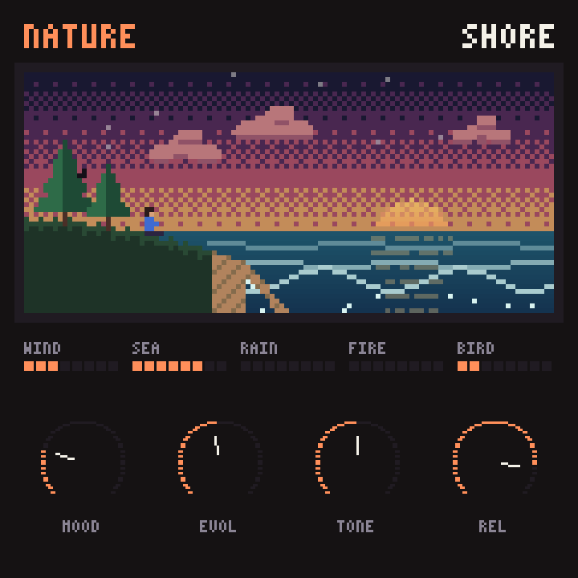

# NATURE for the M-VAVE FM-1

 

**A pocket window onto the weather.** NATURE turns the FM-1 into a generative nature machine: wind in the pines, waves
breaking on a shore, rain, a crackling campfire, birdsong, crickets at night, wind chimes and thunder far away. It never
loops and never repeats: every sound is made right now, by the FM-1 itself, and the scene keeps changing on its own.

**[Try it in your browser](https://gorgonzola777.github.io/nature-fm1/)** (the same code the FM-1 runs, no FM-1
needed) · **[Download](../../releases/latest)** · **[Manual](docs/MANUAL.md)** ·
**[Cheat sheet (PDF)](docs/NATURE-cheatsheet.pdf)**

## What it is

Switch the FM-1 on and you are on a shore at dusk. A person sits on the hill, the sea rolls in, a bird sings in the
pine. Press a white key and you are somewhere else: in a storm, a forest, by a campfire, out at night. Press a black key
and something happens: thunder rolls, a big wave breaks, a gust shakes the trees. Press harder, and it happens harder.

The screen is a pixel-art landscape that follows the sound, not a picture beside it: the waves on the screen break
when you hear them break, lightning strikes with the thunder, sparks fly when the fire crackles, the bird sings when
you hear it, the person opens an umbrella when it rains, the moon and the crickets come out at night.

## How it works

Nothing is recorded. Every layer is synthesised in real time, in fixed-point C on the FM-1's own chip:

- **Wind**: pink noise through gusting band-pass filters, a whistle that rises in a storm, a low rumble under it.
- **Sea**: waves on their own slow clock; each one swells, breaks into bright noise at its crest, then hisses away as
  foam. A storm makes them bigger and closer together.
- **Rain**: a hiss and thousands of single drops, each a tiny struck resonance; big drops now and then.
- **Fire**: a flickering low roar and crackles in bursts, sparks in the scene.
- **Birds**: four kinds of song (falling chirps, rising calls, trills, warbles), phrases of their own, quiet in a storm.
- **Crickets**: pulsed trills of three insects, each with its own pitch and rhythm, out at night.
- **Wind chimes**: struck bars in the key and scale you pick, rung by the gusts.
- **Thunder**: long low rumbles that come by themselves when the mood is stormy and it rains.

Over them, a slow **life** of its own: each layer's presence and the mood wander, so a place you leave alone drifts like
real weather. **MOOD** is the one knob that matters most: calm to storm, and every layer answers it.

Then the FM-1's own effects (reverb, echo, chorus, drive), a **LO-FI** stage (bit crush, sample rate, tape wobble, vinyl
dust), a DJ **filter**, a slow **LFO** for any of it, and **TOUR**, which takes you from place to place by itself.

## What it is for

- **Sleep and rest**: pick a place, set the sleep timer (REC: 15 to 90 minutes), it fades out by itself.
- **Focus**: rain or a campfire at a low volume, TOUR on, nothing to touch for hours.
- **Music**: an ambient bed under your playing, live through the FM-1's USB audio into a DAW, or wind chimes in your
  key. Black keys on the sequencer play thunder and waves in time.
- **Play**: it is fun to make a storm with one hand.

## Quick start

1. Switch on: SHORE plays.
2. White keys **F3 to E4** and **D5 to G5**: the places. **F4 to C5**: the layers on / off.
3. Black keys: the events. Hold one and press harder.
4. **KNOB 1**: MOOD, calm to storm. **Hold HOME** for the key map on the screen.
5. **SAVE** keeps your sound for the next power-on.

## Install

- From [The Firmware Hub](https://thefirmwarehub.com) (once it is listed there): one click, in Chrome or Edge, over USB.
- Or download `nature-X.Y.fwsc` from the [releases](../../releases) and install it with
  [M-Flasher](https://github.com/jvitkauskas/m-flasher), or from this repository with
  `python3 tools/fm1_install.py nature-X.Y.fwsc` (needs `pip install mido python-rtmidi`).
- Back to M-VAVE's firmware at any time: [FM1 Workbench](https://open.m-vave.com/fm1-workbench) (V15).
- Older and newer FM-1s alike (both flash chips). Back up your projects before changing firmware.
- If something ever goes wrong: hold **OCT- and OCT+ for 5 s**, the FM-1 goes into the chip's update mode (the screen
  goes dark) and any installer can write it again. Switch it off and on to leave that mode.

## Playing NATURE

The whole screen is the scene, with the place's name on top and the layers and knobs below. Every key, knob and button
does something, and the screen says what it did.

| Control | What it does |
| --- | --- |
| **White keys: places** | F3 SHORE, G3 STORM, A3 FOREST, B3 CAMPFIRE, C4 RAIN, D4 NIGHT, E4 DRIFT, D5 MEADOW, E5 MONSOON, F5 WINTER, G5 DAWN. The scene glides to the new place. The place's key is lit. |
| **White keys: layers** | F4 WIND, G4 SEA, A4 RAIN, B4 FIRE, C5 BIRDS: on / off (lit while on). |
| **Black keys: events** | F#3 THUNDER, G#3 BIG WAVE, A#3 GUST, C#4 DOWNPOUR, D#4 CRACKLE, F#4 BIRD, G#4 BIRD CHORUS, A#4 CALM, C#5 STORM, D#5 CRICKETS, F#5 SHUFFLE. Press harder for a stronger event (key pressure). They fade by themselves. |
| **KNOB 1-4** | the page's four, named on the screen. MAIN: MOOD (calm .. storm), LIFE (how much the scene changes by itself), TONE (dark .. bright), VOL |
| **FX** | FX 1: REVERB, ECHO, ECHO TIME (60 ms .. 2 s), REPEAT. Again: FX 2: CHORUS, DRIVE, ROOM (size), TYPE (room, spring, hall) |
| **LFO** | a slow LFO: TARGET (mood, tone, wind, sea, rain, fire, birds, vol, reverb, echo, filter, chimes), RATE (0.01 .. 3.7 Hz), DEPTH, SHAPE (sine, triangle, square, random) |
| **ENV** | FADE IN, FADE OUT (play / pause), GLIDE (how fast a place changes), EVENT (how long an event lasts) |
| **EDIT** | MIX 1: WIND, SEA, RAIN, FIRE levels (turning one switches its layer on). Again: MIX 2: BIRDS, CRICKETS, THUNDER (how often), CHIMES |
| **SCL** | LO-FI: CRUSH (bits), RATE (sample rate), WOBBLE (tape wow and flutter), DUST (vinyl crackle and hiss) |
| **GLO** | GLOBAL: FILTER (a DJ filter: left low-pass, right high-pass), RESO, PAN, SENS (key pressure) |
| **ARP** | CHIMES: wind chimes the gusts ring. LEVEL, KEY, SCALE (major, minor, Japan, whole tone, Lydian), DECAY |
| **SEQ** | TOUR: it plays itself. TOUR (on / off: the next place every ..), EVERY (30 s .. 20 min), ORDER (next, random), AUTO EV (events by themselves) |
| **REC** | sleep timer: off, 15, 30, 60, 90 min, then it fades out (minutes left on the screen) |
| **SAVE** | this sound at power-on (held 2 s: the factory sound again) |
| **SELECT** | REVERB |
| **ALGORITHM** | TIME: day, dusk, night (crickets and the moon come out) |
| **PRESETS** | the places, one by one |
| **PLAY** | pause / play (fades out and in) |
| **HOME** | on a page: back to MAIN; on MAIN: the place as it was. Held: HELP (the key map) |
| **OCT- / OCT+** | previous / next place |
| **OCT- + OCT+ held 5 s** | update mode (UBOOT), for reinstalling whatever happens |

## Building

As Felucca ([README.felucca.md](README.felucca.md), [BUILDING.md](BUILDING.md)). GitHub builds every push
(`.github/workflows/build.yml`) and every `v*` tag as a release with the FM-1 Firmware Hub's
[fm1-build](https://github.com/zvenson/fm1-build) workflow. Identity: `FM-1_6283XY` (release X.Y), `FM-1_628300` for
test builds.

The engine is `firmware/src/eng_nature.c` (MIT), the scene `firmware/src/ui_nature.c` and the app (screen, keys, knobs,
LEDs) `firmware/src/nature_app.c` (GPL-3.0-only).

## Licence and credits

GPL-3.0-only, as Felucca (see [LICENSING.md](LICENSING.md), [CREDITS.md](CREDITS.md)). Felucca (C) 2026 Leo Kuroshita,
Hügelton Instruments. NATURE engine and screen (C) 2026 Gorgonzola777. Felucca's sample pack: CC0 (VSCO-2 CE, VCSL by
Versilian Studios). M-VAVE and FM-1 are trademarks of their owners; NATURE is not affiliated with M-VAVE or Felucca.
