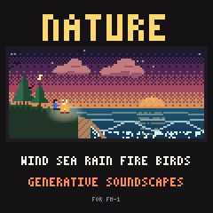

# NATURE for the M-VAVE FM-1

 

**NATURE** turns the FM-1 into a generative soundscape machine: **wind, sea, rain, fire, birds and thunder**, all
synthesised in real time (no samples), mixing and changing by themselves so the scene never repeats. A pixel-art
landscape on the screen follows the sound: waves break when the surf hisses, lightning strikes with the thunder,
sparks fly when the fire crackles, a bird on the pine sings when you hear it, and the person on the hill opens an
umbrella when it rains.

NATURE is built on [Felucca](https://github.com/hugelton/Felucca) by Leo Kuroshita (Hügelton Instruments): its hardware
layer, sound core, USB and update path. The FM-1 runs NATURE only (`FELUCCA_NATURE_APP=0` builds Felucca with NATURE as
one more engine instead).

## Install

Install the `.fwsc` from the [releases](../../releases) (or from [The Firmware Hub](https://thefirmwarehub.com)) in
Chrome or Edge over USB. The installer can always take you back to M-VAVE's official V15. Back up your projects first.

## Playing NATURE

Switch the FM-1 on and NATURE plays: the whole screen is the scene, with the place's name on top and the layers and
knobs below. Every key and knob does something, and the screen says what it did.

| Control | What it does |
| --- | --- |
| **White keys: places** | F3 SHORE, G3 STORM, A3 FOREST, B3 CAMPFIRE, C4 RAIN, D4 NIGHT, E4 DRIFT, D5 MEADOW, E5 MONSOON, F5 WINTER, G5 DAWN. The scene glides to the new place. The place's key is lit. |
| **White keys: layers** | F4 WIND, G4 SEA, A4 RAIN, B4 FIRE, C5 BIRDS: on / off (lit while on). |
| **Black keys: events** | F#3 THUNDER, G#3 BIG WAVE, A#3 GUST, C#4 DOWNPOUR, D#4 CRACKLE, F#4 BIRD, G#4 BIRD CHORUS, A#4 CALM, C#5 STORM, D#5 CRICKETS, F#5 SHUFFLE. Press harder for a stronger event (key pressure). They fade by themselves. |
| **KNOB 1-4** | the page's four, named on the screen. MAIN: MOOD (calm .. storm), LIFE (how much the scene changes by itself), TONE (dark .. bright), VOL |
| **FX** | FX 1: REVERB, ECHO, ECHO TIME (60 ms .. 2 s), REPEAT. Again: FX 2: CHORUS, DRIVE, ROOM (size), TYPE (room, spring, hall) |
| **LFO** | a slow LFO: TARGET (mood, tone, wind, sea, rain, fire, birds, vol, reverb, echo), RATE (0.01 .. 3.7 Hz), DEPTH, SHAPE (sine, triangle, square, random) |
| **ENV** | FADE IN, FADE OUT (play / pause), GLIDE (how fast a place changes), EVENT (how long an event lasts) |
| **EDIT** | MIX 1: WIND, SEA, RAIN, FIRE levels (turning one switches its layer on). Again: MIX 2: BIRDS, CRICKETS, THUNDER (how often), SENS (key pressure) |
| **SELECT** | SPACE (reverb) |
| **ALGORITHM** | TIME: day, dusk, night (crickets and the moon come out) |
| **PRESETS** | the places, one by one |
| **PLAY** | pause / play (fades out and in) |
| **HOME** | on a page: back to MAIN; on MAIN: the place as it was (undoes its changes; effects stay) |
| **OCT- / OCT+** | previous / next place |
| **SCL, GLO, SAVE, ARP, SEQ, REC** | HELP: the key map on the screen; any button or key closes it |
| **OCT- + OCT+ held 5 s** | update mode (UBOOT), for reinstalling whatever happens |

## Building

As Felucca ([README.felucca.md](README.felucca.md), [BUILDING.md](BUILDING.md)). GitHub builds every push
(`.github/workflows/build.yml`) and every `v*` tag as a release with the FM-1 Firmware Hub's
[fm1-build](https://github.com/zvenson/fm1-build) workflow. Identity: `FM-1_6283XY` (release X.Y), `FM-1_628300` for
test builds.

The engine is `firmware/src/eng_nature.c` (MIT), the scene `firmware/src/ui_nature.c` and the app (screen, keys, knobs,
LEDs) `firmware/src/nature_app.c` (GPL-3.0-only).

## Licence and credits

GPL-3.0-only, as Felucca (see [LICENSING.md](LICENSING.md), [CREDITS.md](CREDITS.md)). Felucca (C) 2026 Leo Kuroshita,
Hügelton Instruments. NATURE engine and screen (C) 2026 Gorgonzola777. Felucca's sample pack: CC0 (VSCO-2 CE, VCSL by
Versilian Studios). M-VAVE and FM-1 are trademarks of their owners; NATURE is not affiliated with M-VAVE or Felucca.
